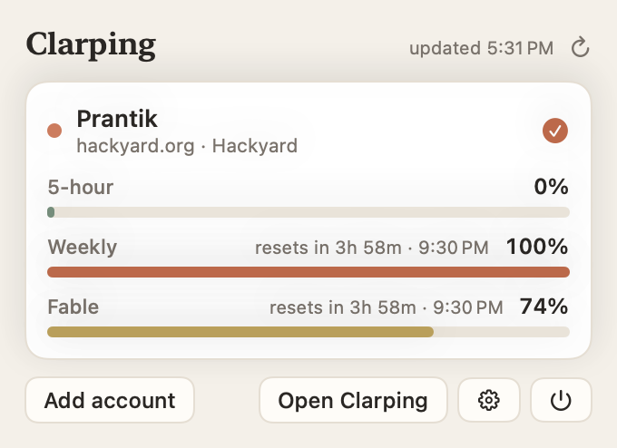
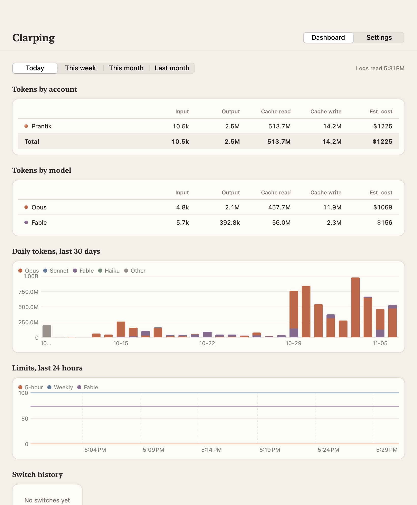

# Clarping

A native macOS menu bar app that keeps several Claude accounts linked on one Mac, shows their rate-limit usage, and switches the login that Claude Code (and optionally Claude Desktop) uses.



## What it does

- **Menu bar**: a four-point spark glyph with a thin arc showing the active account's 5-hour utilization, plus compact text such as `42% · 1h 12m` (toggle in Settings). The spark rotates and breathes while a switch is in progress; Reduce Motion disables that.
- **Popover**: one card per linked account with soft gauges for the 5-hour window, the weekly window and any per-model weekly limit the API reports (for example Fable), reset times, and a burn-rate projection for the active account. Click another card, confirm, and Clarping switches to it. Progress and errors ("Re-login needed") show inline.
- **Dashboard** (Open Clarping, or Cmd-, for Settings): tokens by account and by model family for today / this week / this month / last month, an approximate API-equivalent cost, a 30-day daily chart, a 24-hour chart of the active account's limits, and the switch history. Data comes from Claude Code's own session logs.
- **Poller**: every N minutes (default 3) it fetches usage for every linked account, refreshes stored tokens of inactive accounts when they are about to expire, posts notifications when a limit crosses 80% or 95%, and highlights the least-used account when the active one reaches 95%.



## Build and install

Requirements: macOS 14 or later, Swift 5.9+ (Command Line Tools are enough; no Xcode needed).

```sh
scripts/build-app.sh          # swift build -c release, then assembles build/Clarping.app
open build/Clarping.app
```

`scripts/make-icon.sh` draws the app icon in code and packages it as `.icns`; `build-app.sh` runs it when the icon is missing. The bundle is ad-hoc signed (`codesign -s -`). Copy `build/Clarping.app` to `/Applications` if you want "Launch at login" to work reliably.

Useful flags:

```sh
build/Clarping.app/Contents/MacOS/Clarping --add-current             # capture the active login headlessly
build/Clarping.app/Contents/MacOS/Clarping --dry-run-selftest /tmp/h  # exercise capture -> switch -> verify against fake files
```

## How linking works

"Add account" (or `--add-current`) reads the login that is active right now and stores it in Clarping's vault. Before anything is stored, the keychain token is checked against the profile endpoint: it must belong to the account named in `~/.claude.json`, otherwise the capture is refused (a stale `claude` process writing an old login back can therefore never overwrite another account's copy). Nothing of Claude's is modified by this step, except that with Desktop switching enabled, Claude Desktop is quit for the copy and relaunched (its SQLite and LevelDB files cannot be copied safely while it runs; with the setting off and Desktop running, the Desktop login is skipped and a note says so). If Desktop is signed in as a different account than the CLI, its login is not filed under the CLI account; sign Desktop into the same account and re-capture. To link a second account: sign out and in with `claude` (and in Claude Desktop, if you use it), then press "Add account" again.

What is read:

| Source | What is taken |
| --- | --- |
| Keychain item `Claude Code-credentials` (account = your user name) | only the `claudeAiOauth` block |
| `~/.claude.json` | only the `oauthAccount` block |
| `~/Library/Application Support/Claude/` | `Cookies`, `Cookies-journal`, `Local Storage`, `Session Storage`, `IndexedDB/https_claude.ai_0.indexeddb.leveldb`, `IndexedDB/https_claude.ai_0.indexeddb.blob` |
| `~/Library/Application Support/Claude/config.json` | only the keys `oauth:tokenCache`, `oauth:tokenCacheV2`, `lastKnownAccountUuid`, `bootSideSessions` |

Where it goes:

| Vault location | Contents |
| --- | --- |
| Keychain service `Clarping`, account `<accountId>:cli` | the `claudeAiOauth` JSON |
| Keychain service `Clarping`, account `<accountId>:desktop-config` | the four Desktop config keys |
| `~/Library/Application Support/Clarping/desktop/<accountId>/` (mode 0700) | copies of the Desktop auth files |
| `~/Library/Application Support/Clarping/accounts.json` | label, color, email, org, the `oauthAccount` block (no secrets) |
| `~/Library/Application Support/Clarping/*.json` | settings, usage snapshots, switch log, token statistics (no secrets) |

## How switching works

1. If Claude Desktop is running and Desktop switching is on, quit it (AppleScript `quit`, then wait until the process is gone) so its files are quiescent.
2. Re-capture the active account into the vault (refresh tokens rotate, so the vault must hold whatever the CLI holds now).
3. Back up: `~/.claude.json` to `~/Library/Application Support/Clarping/backups/<timestamp>-claude.json` (0600, last 20 entries kept); the live Desktop auth files to `backups/<timestamp>-desktop/` (0700); the whole Claude Code keychain item and Desktop's login keys inside the keychain (`Clarping` / `backup:cli-latest` and `backup:desktop-config-latest`). The `backups/` and `desktop/` folders are excluded from Time Machine.
4. Write the target's `claudeAiOauth` into the existing `Claude Code-credentials` item with `SecItemUpdate`, so the item keeps its access list. Every other key in that item, notably `mcpOAuth` with the MCP server logins, is preserved. If the item does not exist, the switch is refused (run `claude /login` once): an item created by Clarping would make the CLI prompt on every read. If the target is already the active CLI account, steps 4 and 5 are skipped (the live item is newer than the vault).
5. Patch `~/.claude.json`: replace `oauthAccount`, drop the account-keyed caches `cachedUsageUtilization`, `cachedArtifactRoster`, `passesEligibilityCache`, `overageCreditGrantCache` so they refresh. Nothing else is touched (`userID`, `anonymousId`, `machineID`, `projects`, `mcpServers`, `providerProfiles` and the rest stay as they are; key order may change). Written atomically via a temp file and rename, keeping the original file mode.
6. Restore the target's Desktop auth files and merge its four config keys into `config.json` at key level, then relaunch Desktop if it was running.
7. Log the switch (used to attribute tokens in the dashboard).

If anything fails after step 4, the keychain item, the `oauthAccount` block (re-applied onto the current file, so a CLI write made meanwhile survives) and the Desktop auth files are rolled back and Desktop is relaunched. Polling pauses while a switch runs, and a switch waits for any in-flight token refresh of its target. The confirm step warns when `claude` processes are running: they keep the old login until restarted and can write `~/.claude.json` during the switch.

The active account is never token-refreshed by Clarping: its refresh token belongs to the CLI, and rotating it from outside would log the CLI out. Clarping reads the active login from the keychain on every poll and, before filing it under an account, confirms with the profile endpoint that the token really belongs to that account id.

All file and keychain locations live in one `Paths` struct, so the self-test runs the real `Switcher` against a temporary HOME and the throwaway keychain services `Clarping-Test` / `Clarping-Test-CLI`, then cleans up.

## Limitations

- **Desktop cookies are machine-bound.** Claude Desktop encrypts cookie values with the `Claude Safe Storage` keychain key; Clarping copies the encrypted files as they are, so a vault only works on the Mac that captured it. Desktop also keeps caches of web state outside the copied files; if it looks confused after a switch, sign out and in once and re-capture.
- **Claude Code caches the keychain read for about 30 seconds**, and a running `claude` session keeps using the token it already has until you restart it. Start new sessions after switching.
- **Desktop's Code tab / Cowork** already keep their own per-account data; Clarping does not touch `claude-code-sessions/`, `local-agent-mode-sessions/`, `scratch-workspaces/`, `vm_bundles/` or `claude_desktop_config.json`.
- **Cost is approximate.** It applies public API list prices (Opus and Fable $15/$75, Sonnet $3/$15, Haiku $1/$5 per million tokens; cache read 10% and cache write 125% of the input price) to the token counts in Claude Code's logs. Subscriptions are not billed per token; the number is only a sense of scale.
- **Token attribution** uses Clarping's own switch log, per message timestamp. Tokens logged before the first switch belong to the account that switch came from; with no switches at all they belong to the active account. Accounts since removed show as "Removed account".
- **Refresh tokens rotate.** Clarping refreshes an inactive account only once its access token has actually expired, because a `claude` session of that account may still hold the same refresh token and whoever refreshes first invalidates the other. When the stored refresh token is rejected, the card says the login was rotated elsewhere: make that account active with `claude /login`, then re-capture it.
- **Keychain access and prompts.** Secrets never appear on a command line or in the environment. Clarping's own items use Security.framework; the Claude Code item is read with `security find-generic-password -w` over a pipe (the tool that created it, so no prompt) and written with `SecItemUpdate`. That write shows one macOS keychain prompt for Clarping on the first real switch; choose "Always Allow". The app is ad-hoc signed, so a rebuild changes its identity and the prompt returns once.
- **Backups and snapshots on disk.** `backups/<ts>-claude.json` holds no login tokens but can contain MCP server settings; `backups/<ts>-desktop/` and `desktop/<id>/` hold Desktop cookies and storage whose values Desktop already encrypted with its keychain key. All are mode 0600/0700 and excluded from Time Machine.
- Built with the Command Line Tools toolchain only; `@State` is unavailable there (no SwiftUI macro plugin), so views keep local state in `@StateObject` boxes.

## Repository layout

```
Package.swift
Sources/Clarping/
  Main.swift            entry point, CLI flags, window management
  AppState.swift        observable state, poller, notifications, projections
  Core/Paths.swift      every path and keychain service name (real vs. test)
  Core/Keychain.swift   Security.framework wrapper (plus a piped `security` read for the CLI item)
  Core/Models.swift     Account, CLICreds, UsageSnapshot, Settings, formatting
  Core/Vault.swift      Clarping's own storage
  Core/ClaudeAPI.swift  token refresh, usage, profile
  Core/Switcher.swift   capture and switch flow
  Core/TokenIngest.swift incremental JSONL ingestion, pricing
  Core/SelfTest.swift   --dry-run-selftest
  UI/                   popover, dashboard, settings, gauges, menu bar glyph, theme
scripts/build-app.sh    swift build + .app assembly + codesign
scripts/make-icon.sh    code-drawn icon -> .icns
docs/screenshots/
```
